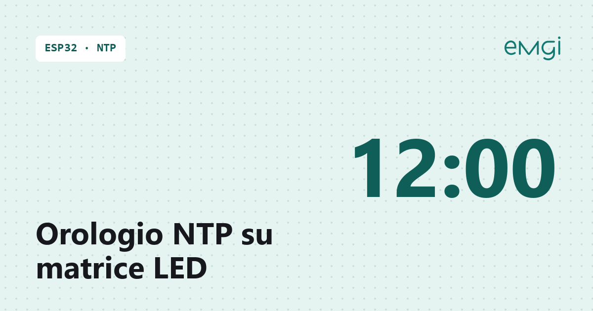

# Orologio NTP con ESP32 e doppia matrice WS2812B 8×32

> 📖 **Articolo completo con schema, foto e spiegazioni passo passo:**  
> **[Orologio NTP con ESP32 e doppia matrice WS2812B 8×32 – www.emgi.it](https://www.emgi.it/2026/04/02/orologio-ntp-con-esp32-e-doppia-matrice-ws2812b-8x32/)**
>
> Altri progetti di elettronica, Arduino, ESP32, Home Assistant e stampa 3D su **[www.emgi.it](https://www.emgi.it)**

In questo progetto realizzo un **orologio NTP con ESP32** usando **due pannelli NeoPixel WS2812B 8×32** uno sopra l’altro: il pannello superiore mostra l’**ora**, quello inferiore la **data**.

L’ora arriva da Internet e si regola da sola, anche al cambio tra ora solare e ora legale. Tutto il resto si configura da una pagina web, senza ricompilare il codice.

## Hardware utilizzato

- 1 × **ESP32 WROOM32** (ESP32 Dev Module)
- 2 × **pannelli WS2812B 8×32**
- 1 × alimentatore **5V** adeguato alla corrente dei LED
- cavi di collegamento, con **massa comune** tra ESP32 e alimentatore dei LED

- una **resistenza da 330–470 Ω** in serie su ciascun pin dati
- un **condensatore elettrolitico** (es. 1000 µF) tra 5V e GND vicino alle matrici

## Librerie e impostazioni IDE

- **Core ESP32** di Espressif, versione 3.x (testato con la 3.3.12) dal Gestore schede
- libreria **Adafruit NeoPixel** dal Gestore librerie
- le altre librerie (WiFi, WebServer, Preferences, ArduinoOTA, ESPmDNS) sono già incluse nel core
- scheda: **ESP32 Dev Module**, schema di partizione predefinito (lo sketch occupa circa l’80% dello spazio)

## Contenuto del repository

| Percorso | Descrizione |
|---|---|
| `orologio_ntp_esp32/orologio_ntp_esp32.ino` | Sketch Arduino |
| `home_assistant/configuration.yaml.example` | Configurazione YAML |
| `immagini/` | Foto e immagini dell'articolo |

## Come si usa

1. Apri [`orologio_ntp_esp32/orologio_ntp_esp32.ino`](orologio_ntp_esp32) con Arduino IDE.
2. Inserisci `WIFI_SSID` e `WIFI_PASS` (rete a 2,4 GHz); facoltativi `HOSTNAME`, fuso orario e link fissi.
3. Per Home Assistant vedi [`home_assistant/configuration.yaml.example`](home_assistant/configuration.yaml.example) (sostituisci `IP_OROLOGIO`).

Schema dei collegamenti, dettagli e risoluzione dei problemi: **[articolo su www.emgi.it](https://www.emgi.it/2026/04/02/orologio-ntp-con-esp32-e-doppia-matrice-ws2812b-8x32/)**.

## Licenza

- Codice e configurazioni: [MIT](LICENSE)
- Modelli 3D, schemi e immagini: [CC BY-SA 4.0](https://creativecommons.org/licenses/by-sa/4.0/deed.it)

---

**Autore:** Massimiliano Sandrin – **[eMGi.it](https://www.emgi.it)** · Domande e commenti sotto l'[articolo sul sito](https://www.emgi.it/2026/04/02/orologio-ntp-con-esp32-e-doppia-matrice-ws2812b-8x32/).
